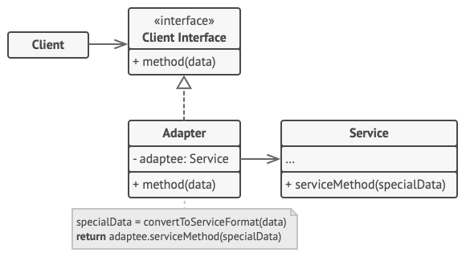

## 意图
**适配器模式**是一种结构型设计模式， 它能使接口不兼容的对象能够相互合作。

## 适配器模式结构



1. **客户端** （Client） 是包含当前程序业务逻辑的类。
2. **客户端接口** （Client Interface） 描述了其他类与客户端代码合作时必须遵循的协议。
3. **服务** （Service） 中有一些功能类 （通常来自第三方或遗留系统）。 客户端与其接口不兼容， 因此无法直接调用其功能。
4. **适配器** （Adapter） 是一个可以同时与客户端和服务交互的类： 它在实现客户端接口的同时封装了服务对象。 适配器接受客户端通过适配器接口发起的调用， 并将其转换为适用于被封装服务对象的调用。
5. 客户端代码只需通过接口与适配器交互即可， 无需与具体的适配器类耦合。 因此， 你可以向程序中添加新类型的适配器而无需修改已有代码。 这在服务类的接口被更改或替换时很有用： 你无需修改客户端代码就可以创建新的适配器类。

## 实例

### 1. 定义客户端接口

首先定义客户端接口 `ClientInterface`。

```java
// ClientInterface.java
public interface ClientInterface {
    void request();
}
```

### 2. 定义服务类

然后创建服务类 `Service`，它有一个不兼容客户端接口的方法。

```java
// Service.java
public class Service {
    public void specificRequest() {
        System.out.println("Service: Specific request.");
    }
}
```

### 3. 创建适配器类

接下来创建适配器类 `Adapter`，它实现客户端接口并封装服务对象。

```java
// Adapter.java
public class Adapter implements ClientInterface {
    private Service service;

    public Adapter(Service service) {
        this.service = service;
    }

    @Override
    public void request() {
        service.specificRequest();
    }
}
```

### 4. 客户端代码

最后是客户端代码，通过适配器与服务类交互。

```java
// Client.java
public class Client {
    public static void main(String[] args) {
        Service service = new Service();
        ClientInterface adapter = new Adapter(service);
        adapter.request();
    }
}
```

### 运行结果

```
Service: Specific request.
```

在这个示例中，客户端代码使用了适配器模式来调用服务类的方法。通过适配器，客户端可以使用与其接口兼容的方式与服务类交互，而不需要改变服务类的代码。


