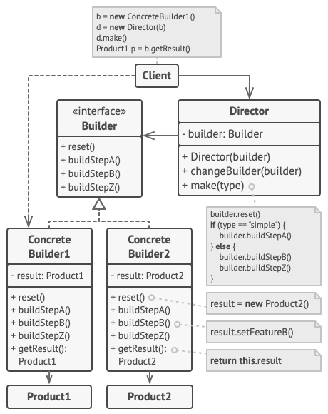

## 意图

**生成器模式**是一种创建型设计模式，使你能够分步骤创建复杂对象。该模式允许你使用相同的创建代码生成不同类型和形式的对象。


## 建造者模式结构

1. **生成器** （Builder） 接口声明在所有类型生成器中通用的产品构造步骤。
2. **具体生成器** （Concrete Builders） 提供构造过程的不同实现。 具体生成器也可以构造不遵循通用接口的产品。
3. **产品** （Products） 是最终生成的对象。 由不同生成器构造的产品无需属于同一类层次结构或接口。
4. **主管** （Director） 类定义调用构造步骤的顺序， 这样你就可以创建和复用特定的产品配置。
5. **客户端** （Client） 必须将某个生成器对象与主管类关联。 一般情况下， 你只需通过主管类构造函数的参数进行一次性关联即可。 此后主管类就能使用生成器对象完成后续所有的构造任务。 但在客户端将生成器对象传递给主管类制造方法时还有另一种方式。 在这种情况下， 你在使用主管类生产产品时每次都可以使用不同的生成器。

通常情况下，我们也可以只有 **具体生成器** 和 **产品** 两种角色。

## 实例

接下来，我们将构建一个更完整的建造者模式示例。这个示例将包括一个抽象建造者接口、两个具体建造者实现以及两种不同的产品。这里以构建不同类型的汽车为例，我们将创建两种汽车：轿车和卡车。

### 1. 定义产品类

```java Car.class
public abstract class Car {

    private String model;
    private String engine;
    private String color;

    public Car(String model, String engine, String color) {
        this.model = model;
        this.engine = engine;
        this.color = color;
    }

    public String getModel() {
        return model;
    }

    public String getEngine() {
        return engine;
    }

    public String getColor() {
        return color;
    }

    @Override
    public String toString() {
        return "Car{" +
                "model='" + model + '\'' +
                ", engine='" + engine + '\'' +
                ", color='" + color + '\'' +
                '}';
    }
}

```





```java Sedan.class
public class Sedan extends Car{
    public Sedan(String model, String engine, String color) {
        super(model, engine, color);
    }
}
```



```java Truck.class
public class Truck extends Car{
    public Truck(String model, String engine, String color) {
        super(model, engine, color);
    }
}
```



### 2. 定义抽象建造者



public abstract class AbstractCarBuilder {
    
    protected Car car;

    public AbstractCarBuilder() {
        this.car = createCar();
    }

    protected abstract Car createCar();

    public abstract void buildModel();

    public abstract void buildEngine();

    public abstract void buildColor();

    public Car getCar() {
        return car;
    }
}



### 3. 定义具体建造者 SedanBuilder 和 TruckBuilder


```java SedanBuilder.class
public class SedanBuilder extends AbstractCarBuilder {

    @Override
    protected Car createCar() {
        return new Car("Sedan", null, null);
    }

    @Override
    public void buildModel() {
        car.setModel("Sedan");
    }

    @Override
    public void buildEngine() {
        car.setEngine("2.0L Turbo");
    }

    @Override
    public void buildColor() {
        car.setColor("Red");
    }
}
```



```java 
public class TruckBuilder extends AbstractCarBuilder {

    @Override
    protected Car createCar() {
        return new Car("Truck", null, null);
    }

    @Override
    public void buildModel() {
        car.setModel("Truck");
    }

    @Override
    public void buildEngine() {
        car.setEngine("3.5L V6");
    }

    @Override
    public void buildColor() {
        car.setColor("Blue");
    }
}
```



### 4. 定义主管类 Director



```java Director.class
public class Director {

    private AbstractCarBuilder builder;

    public Director(AbstractCarBuilder builder) {
        this.builder = builder;
    }

    public Car constructCar() {
        builder.buildModel();
        builder.buildEngine();
        builder.buildColor();
        return builder.getCar();
    }
}

```




### 5. 创建实列


```java Main.class

public class Main {

    public static void main(String[] args) {
        Director director = new Director(new SedanBuilder());
        Car sedan = director.constructCar();
        System.out.println(sedan);

        director = new Director(new TruckBuilder());
        Car truck = director.constructCar();
        System.out.println(truck);
    }

}

```



在这个例子中：
- Car 是抽象的产品类，定义了汽车的基本结构。
- CarBuilder 是抽象建造者接口，定义了构建汽车的方法。
- SedanBuilder 和 TruckBuilder 分别实现了具体的建造者，用于构建不同类型的汽车。
- Director 类负责指导具体的建造者来构建产品。
通过这种方式，我们可以灵活地创建不同类型的产品，而不需要修改产品类或具体建造者类的代码。