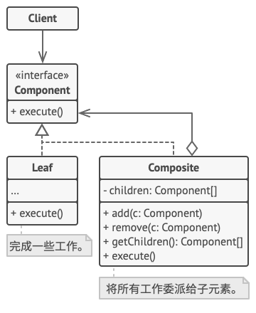

## 意图

**组合模式**是一种结构型设计模式，你可以使用它将对象组合成树状结构，并且能够像使用独立对象一样使用它们。

## 模式结构



1. **组件** （Component） 接口描述了树中简单项目和复杂项目所共有的操作。
2. **叶节点** （Leaf） 是树的基本结构， 它不包含子项目。一般情况下， 叶节点最终会完成大部分的实际工作， 因为它们无法将工作指派给其他部分。
3. **容器** （Container）——又名 “组合 （Composite）”——是包含叶节点或其他容器等子项目的单位。 容器不知道其子项目所属的具体类， 它只通过通用的组件接口与其子项目交互。容器接收到请求后会将工作分配给自己的子项目， 处理中间结果， 然后将最终结果返回给客户端。
4. **客户端** （Client） 通过组件接口与所有项目交互。 因此， 客户端能以相同方式与树状结构中的简单或复杂项目交互。

## 实例

### 1. 定义组件接口

首先定义组件接口 `Component`。

```java
// Component.java
public interface Component {
    void operation();
}
```

### 2. 定义叶节点类

然后创建叶节点类 `Leaf`，它实现组件接口。

```java
// Leaf.java
public class Leaf implements Component {
    private String name;

    public Leaf(String name) {
        this.name = name;
    }

    @Override
    public void operation() {
        System.out.println("Leaf " + name + " operation.");
    }
}
```

### 3. 定义容器类

接下来创建容器类 `Composite`，它也实现组件接口，并且可以包含子组件。

```java
// Composite.java
import java.util.ArrayList;
import java.util.List;

public class Composite implements Component {
    private List<Component> children = new ArrayList<>();

    public void add(Component component) {
        children.add(component);
    }

    public void remove(Component component) {
        children.remove(component);
    }

    public Component getChild(int index) {
        return children.get(index);
    }

    @Override
    public void operation() {
        System.out.println("Composite operation.");
        for (Component child : children) {
            child.operation();
        }
    }
}
```

### 4. 客户端代码

最后是客户端代码，通过组合模式来操作叶节点和容器。

```java
// Client.java
public class Client {
    public static void main(String[] args) {
        Leaf leaf1 = new Leaf("1");
        Leaf leaf2 = new Leaf("2");

        Composite composite = new Composite();
        composite.add(leaf1);
        composite.add(leaf2);

        Composite root = new Composite();
        root.add(composite);
        root.add(new Leaf("3"));

        root.operation();
    }
}
```

### 运行结果

```
Composite operation.
Composite operation.
Leaf 1 operation.
Leaf 2 operation.
Leaf 3 operation.
```

在这个示例中，客户端代码使用了组合模式来操作叶节点和容器。通过组合模式，客户端可以像使用独立对象一样使用组合对象，从而实现更灵活的对象结构。

