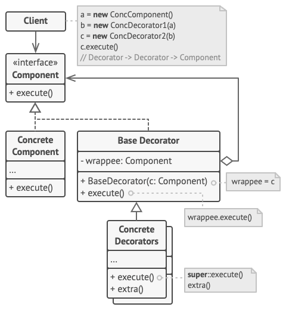

## 意图

**装饰模式**是一种结构型设计模式， 允许你通过将对象放入包含行为的特殊封装对象中来为原对象绑定新的行为。

## 模式结构



1. **部件** （Component） 声明封装器和被封装对象的公用接口。
2. **具体部件** （Concrete Component） 类是被封装对象所属的类。 它定义了基础行为， 但装饰类可以改变这些行为。
3. **基础装饰** （Base Decorator） 类拥有一个指向被封装对象的引用成员变量。 该变量的类型应当被声明为通用部件接口， 这样它就可以引用具体的部件和装饰。 装饰基类会将所有操作委派给被封装的对象。
4. **具体装饰类** （Concrete Decorators） 定义了可动态添加到部件的额外行为。 具体装饰类会重写装饰基类的方法， 并在调用父类方法之前或之后进行额外的行为。
5. **客户端** （Client） 可以使用多层装饰来封装部件， 只要它能使用通用接口与所有对象互动即可。

## 代码示例

### 1. 定义组件接口

首先定义组件接口 `Component`。

```java
// Component.java
public interface Component {
    String operation();
}
```

### 2. 定义具体组件类

然后创建具体组件类 `ConcreteComponent`，它实现组件接口。

```java
// ConcreteComponent.java
public class ConcreteComponent implements Component {
    @Override
    public String operation() {
        return "ConcreteComponent";
    }
}
```

### 3. 定义基础装饰类

接下来创建基础装饰类 `Decorator`，它实现组件接口并包含一个指向组件的引用。

```java
// Decorator.java
public class Decorator implements Component {
    protected Component component;

    public Decorator(Component component) {
        this.component = component;
    }

    @Override
    public String operation() {
        return component.operation();
    }
}
```

### 4. 定义具体装饰类

然后创建具体装饰类 `ConcreteDecoratorA` 和 `ConcreteDecoratorB`，它们扩展基础装饰类并添加额外的行为。

```java
// ConcreteDecoratorA.java
public class ConcreteDecoratorA extends Decorator {
    public ConcreteDecoratorA(Component component) {
        super(component);
    }

    @Override
    public String operation() {
        return "ConcreteDecoratorA(" + super.operation() + ")";
    }
}

// ConcreteDecoratorB.java
public class ConcreteDecoratorB extends Decorator {
    public ConcreteDecoratorB(Component component) {
        super(component);
    }

    @Override
    public String operation() {
        return "ConcreteDecoratorB(" + super.operation() + ")";
    }
}
```

### 5. 客户端代码

最后是客户端代码，通过装饰模式来动态地为对象添加行为。

```java
// Client.java
public class Client {
    public static void main(String[] args) {
        Component component = new ConcreteComponent();
        System.out.println("Original: " + component.operation());

        Component decorated1 = new ConcreteDecoratorA(component);
        System.out.println("Decorated with A: " + decorated1.operation());

        Component decorated2 = new ConcreteDecoratorB(decorated1);
        System.out.println("Decorated with A and B: " + decorated2.operation());
    }
}
```

### 运行结果

```
Original: ConcreteComponent
Decorated with A: ConcreteDecoratorA(ConcreteComponent)
Decorated with A and B: ConcreteDecoratorB(ConcreteDecoratorA(ConcreteComponent))
```

在这个示例中，客户端代码使用了装饰模式来动态地为对象添加行为。通过装饰模式，客户端可以在运行时组合不同的装饰，从而实现更灵活的对象行为。

