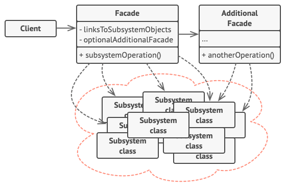

## 意图

**外观模式**是一种结构型设计模式， 能为程序库、 框架或其他复杂类提供一个简单的接口。


## 模式结构


1. **外观** （Facade） 提供了一种访问特定子系统功能的便捷方式， 其了解如何重定向客户端请求， 知晓如何操作一切活动部件。
2. 创建**附加外观** （Additional Facade） 类可以避免多种不相关的功能污染单一外观， 使其变成又一个复杂结构。 客户端和其他外观都可使用附加外观。
3. **复杂子系统** （Complex Subsystem） 由数十个不同对象构成。 如果要用这些对象完成有意义的工作， 你必须深入了解子系统的实现细节， 比如按照正确顺序初始化对象和为其提供正确格式的数据。子系统类不会意识到外观的存在， 它们在系统内运作并且相互之间可直接进行交互。
4. **客户端** （Client） 使用外观代替对子系统对象的直接调用。


## 代码示例

1. 定义子系统
首先定义子系统的一些类。

```java
// 子系统：音频系统
class AudioSystem {
    public void turnOn() {
        System.out.println("Audio system is turned on.");
    }

    public void turnOff() {
        System.out.println("Audio system is turned off.");
    }

    public void setVolume(int volume) {
        System.out.println("Audio system volume set to " + volume + ".");
    }
}

// 子系统：视频系统
class VideoSystem {
    public void turnOn() {
        System.out.println("Video system is turned on.");
    }

    public void turnOff() {
        System.out.println("Video system is turned off.");
    }

    public void playVideo(String video) {
        System.out.println("Video system is playing: " + video + ".");
    }
}

// 子系统：投影仪
class Projector {
    public void turnOn() {
        System.out.println("Projector is turned on.");
    }

    public void turnOff() {
        System.out.println("Projector is turned off.");
    }

    public void setInput(String input) {
        System.out.println("Projector input set to: " + input + ".");
    }
}
```

2. 创建外观
然后创建外观类，它将子系统的功能组合成一个更简单的接口。

```java
// 外观类：提供一个统一的接口
class MultimediaFacade {
    private AudioSystem audioSystem;
    private VideoSystem videoSystem;
    private Projector projector;

    public MultimediaFacade() {
        this.audioSystem = new AudioSystem();
        this.videoSystem = new VideoSystem();
        this.projector = new Projector();
    }

    // 提供简化接口：启动多媒体系统
    public void startMovie(String video) {
        System.out.println("Starting the movie...");
        audioSystem.turnOn();
        audioSystem.setVolume(10);
        videoSystem.turnOn();
        videoSystem.playVideo(video);
        projector.turnOn();
        projector.setInput("HDMI");
    }

    // 提供简化接口：关闭多媒体系统
    public void endMovie() {
        System.out.println("Ending the movie...");
        audioSystem.turnOff();
        videoSystem.turnOff();
        projector.turnOff();
    }
}
```

3. 客户端代码
最后是客户端代码，通过外观来控制子系统。

```java
// 客户端代码
public class Client {
    public static void main(String[] args) {
        // 创建外观对象
        MultimediaFacade multimediaFacade = new MultimediaFacade();

        // 使用外观接口启动电影
        multimediaFacade.startMovie("The Matrix");

        // 使用外观接口关闭电影
        multimediaFacade.endMovie();
    }
}
```

运行结果

``` 
Starting the movie...
Audio system is turned on.
Audio system volume set to 10.
Video system is turned on.
Video system is playing: The Matrix.
Projector is turned on.
Projector input set to: HDMI.
Ending the movie...
Audio system is turned off.
Video system is turned off.
Projector is turned off.
```

