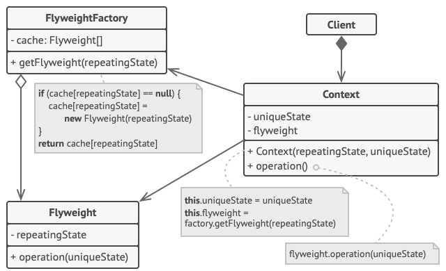

## 意图

**享元模式**是一种结构型设计模式， 它能帮助你在大量对象中有效地共享相同的状态。

### 享元工厂

为了能更方便地访问各种享元， 你可以创建一个工厂方法来管理已有享元对象的缓存池。 工厂方法从客户端处接收目标享元对象的内在状态作为参数， 如果它能在缓存池中找到所需享元， 则将其返回给客户端； 如果没有找到， 它就会新建一个享元， 并将其添加到缓存池中。

你可以选择在程序的不同地方放入该函数。 最简单的选择就是将其放置在享元容器中。 除此之外， 你还可以新建一个工厂类， 或者创建一个静态的工厂方法并将其放入实际的享元类中。

## 模式结构



1. **享元模式**只是一种优化。 在应用该模式之前， 你要确定程序中存在与大量类似对象同时占用内存相关的内存消耗问题， 并且确保该问题无法使用其他更好的方式来解决。
2. **享元** （Flyweight） 类包含原始对象中部分能在多个对象中共享的状态。 同一享元对象可在许多不同情景中使用。 享元中存储的状态被称为 “内在状态”。 传递给享元方法的状态被称为 “外在状态”。
3. **情景** （Context） 类包含原始对象中各不相同的外在状态。 情景与享元对象组合在一起就能表示原始对象的全部状态。
4. 通常情况下， 原始对象的行为会保留在享元类中。 因此调用享元方法必须提供部分外在状态作为参数。 但你也可将行为移动到情景类中， 然后将连入的享元作为单纯的数据对象。
5. **客户端** （Client） 负责计算或存储享元的外在状态。 在客户端看来， 享元是一种可在运行时进行配置的模板对象， 具体的配置方式为向其方法中传入一些情景数据参数。
6. **享元工厂** （Flyweight Factory） 会对已有享元的缓存池进行管理。 有了工厂后， 客户端就无需直接创建享元， 它们只需调用工厂并向其传递目标享元的一些内在状态即可。 工厂会根据参数在之前已创建的享元中进行查找， 如果找到满足条件的享元就将其返回； 如果没有找到就根据参数新建享元。

## 代码示例

为了实现享元模式的示例，我们需要创建以下几个类：
1. `Flyweight`：定义一个接口，通过它可以接受并作用于外部状态。

```java
// Flyweight.java
public interface Flyweight {
    void operation(String extrinsicState);
}
```

2. `ConcreteFlyweight`：实现`Flyweight`接口，并为内部状态（如果有的话）存储空间。`ConcreteFlyweight`对象必须是可共享的。任何`ConcreteFlyweight`对象的状态都必须是内部的；也就是说，它必须独立于`Flyweight`对象的场景。

```java
// ConcreteFlyweight.java
public class ConcreteFlyweight implements Flyweight {
    private final String intrinsicState;

    public ConcreteFlyweight(String intrinsicState) {
        this.intrinsicState = intrinsicState;
    }

    @Override
    public void operation(String extrinsicState) {
        System.out.println("Intrinsic State: " + intrinsicState);
        System.out.println("Extrinsic State: " + extrinsicState);
    }
}
```


3. `UnsharedConcreteFlyweight`：并非所有的Flyweight子类都需要被共享。Flyweight接口使共享成为可能，但它并不强制共享。在Flyweight对象结构的某些层次，UnsharedConcreteFlyweight对象通常将`ConcreteFlyweight`对象作为子节点。

```java
public class UnsharedConcreteFlyweight implements Flyweight {
    private final String allState;

    public UnsharedConcreteFlyweight(String allState) {
        this.allState = allState;
    }

    @Override
    public void operation(String extrinsicState) {
        System.out.println("All State: " + allState);
    }
}
```

4. `FlyweightFactory`：创建并管理`flyweight`对象。确保合理地共享`Flyweight`。当用户请求一个`flyweight`时，`FlyweightFactory`提供一个已创建的实例或创建一个（如果还不存在的话）。

```java
// FlyweightFactory.java
public class FlyweightFactory {
    private final Map<String, Flyweight> flyweights = new HashMap<>();

    public Flyweight getFlyweight(String key) {
        Flyweight flyweight = flyweights.get(key);
        if (flyweight == null) {
            flyweight = new ConcreteFlyweight(key);
            flyweights.put(key, flyweight);
        }
        return flyweight;
    }
}
```

5. `Client`：维护一个对所有`flyweight`的引用。计算或存储一个（多个）`flyweight`的外部状态。

```java
// Client.java
public class Client {
    public static void main(String[] args) {
        FlyweightFactory factory = new FlyweightFactory();

        Flyweight flyweight1 = factory.getFlyweight("A");
        flyweight1.operation("First Call");

        Flyweight flyweight2 = factory.getFlyweight("B");
        flyweight2.operation("Second Call");

        Flyweight flyweight3 = factory.getFlyweight("A");
        flyweight3.operation("Third Call");

        UnsharedConcreteFlyweight unsharedFlyweight = new UnsharedConcreteFlyweight("Unshared State");
        unsharedFlyweight.operation("Unshared Call");
    }
}
```

运行结果

```
Intrinsic State: A
Extrinsic State: First Call
Intrinsic State: B
Extrinsic State: Second Call
Intrinsic State: A
Extrinsic State: Third Call
All State: Unshared State
```

以上代码展示了享元模式的基本实现，包括工厂类、具体享元类、非共享具体享元类以及客户端代码。

