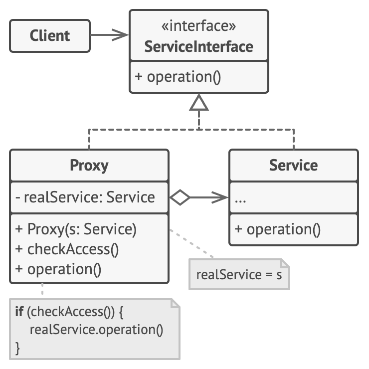

## 意图

**代理模式**是一种结构型设计模式， 让你能够提供对象的替代品或其占位符。 代理控制着对于原对象的访问， 并允许在将请求提交给对象前后进行一些处理。

## 代理模式结构



1. **服务接口** （Service Interface） 声明了服务接口。 代理必须遵循该接口才能伪装成服务对象。 
2. **服务** （Service） 类提供了一些实用的业务逻辑。
3. **代理** （Proxy） 类包含一个指向服务对象的引用成员变量。 代理完成其任务 （例如延迟初始化、 记录日志、 访问控制和缓存等） 后会将请求传递给服务对象。
4. **客户端** （Client） 能通过同一接口与服务或代理进行交互， 所以你可在一切需要服务对象的代码中使用代理。

## 代码示例

1. 声明服务接口 OperationService

```java
package top.wmd001.structural.proxy;

public interface OperationService {

    void operation();

}
```

2. 服务类，提供实际业务逻辑

```java
package top.wmd001.structural.proxy;

public class OperationServiceImpl implements OperationService {
    @Override
    public void operation() {
        System.out.println("OperationServiceImpl operation.");
    }
}
```

3. 代理类-静态代理

```java
package top.wmd001.structural.proxy;

/**
 * 静态代理，代理类和被代理类实现同一个接口，代理类持有被代理类的引用，代理类实现代理方法，代理方法调用被代理类的方法
 * 代理类和被代理类之间强耦合
 *
 * @see top.wmd001.structural.proxy.OperationServiceImpl
 * @author wmd
 */
public class OperationServiceImplProxy implements OperationService {

    private final OperationService operationService;

    public OperationServiceImplProxy(OperationService operationService) {
        this.operationService = operationService;
    }

    @Override
    public void operation() {
        // 代理操作
        System.out.println("OperationServiceImplProxy operation.");
        operationService.operation();
    }
}

```

4. 代理类-JDK动态代理

```java
package top.wmd001.structural.proxy;

import java.lang.reflect.InvocationHandler;
import java.lang.reflect.Method;
import java.lang.reflect.Proxy;

/**
 * JDK动态代理实现
 */
public class OperationServiceImplJdkProxy implements InvocationHandler {

    Object target;

    public OperationServiceImplJdkProxy(Object target) {
        this.target = target;
    }

    @Override
    public Object invoke(Object proxy, Method method, Object[] args) throws Throwable {
        Object result;
        System.out.println("JDK Proxy Before");
        result = method.invoke(target, args);
        System.out.println("JDK Proxy After");
        return result;
    }

    public static Object getProxyInstance(OperationService operationService) {
        return Proxy.newProxyInstance(operationService.getClass().getClassLoader(), operationService.getClass().getInterfaces(), new OperationServiceImplJdkProxy(operationService));
    }

}

```

5. Client

```java
package top.wmd001.structural.proxy;

public class Client {

    public static void main(String[] args) {
        // 使用静态代理执行代理方法
        OperationService operationService = new OperationServiceImpl();
        OperationService operationServiceProxy = new OperationServiceImplProxy(operationService);
        operationServiceProxy.operation();


        // 使用JDK动态代理执行代理方法
        OperationService operationServiceJdkProxy = (OperationService) OperationServiceImplJdkProxy.getProxyInstance(operationService);
        operationServiceJdkProxy.operation();

    }

}
```

运行结果

```
OperationServiceImplProxy operation.
OperationServiceImpl operation.
JDK Proxy Before
OperationServiceImpl operation.
JDK Proxy After
```

以上代码分别演示了使用静态代理和动态代理的方法。

