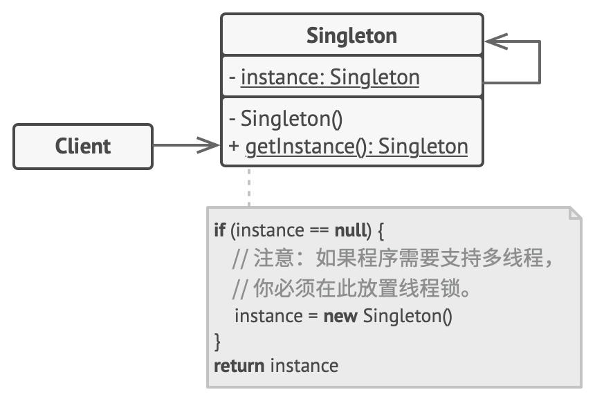

## 意图

**单例模式**是一种创建型设计模式， 让你能够保证一个类只有一个实例， 并提供一个访问该实例的全局节点。

## 单例模式结构



1. **单例** （Singleton） 类声明了一个名为 `getInstance` 获取实例的静态方法来返回其所属类的一个相同实例。


## 实例

要实现一个单例模式，需要经过以下步骤：
1. 创建一个类，该类包含一个私有的构造函数，以防止其他类实例化该对象。
2. 创建一个静态的公有方法，用于返回该类的唯一实例。

假设我们在开发一个微信公众号后台应用，我们需要从微信服务器获取访问api的token，每次请求都需要携带token，因此我们需要一个全局的token，防止多次请求获取token。
代码如下：


```java 
public class WxToken {

    private String token;
    private static WxToken wxToken;

    private WxToken() {
    }

    public static WxToken getInstance() {
        if (wxToken == null) {
            wxToken = new WxToken();
        }
        return wxToken;
    }

    public String getToken() {
        return token;
    }

    public void login() {
        // 忽略登录验证过程
        wxToken.token = "x123456789";
    }

    public static void main(String[] args) {
        WxToken wxToken = WxToken.getInstance();
        wxToken.login();
        System.out.println(wxToken.getToken());
    }

}
```


在main方法中，我们通过`WxToken.getInstance()`获取了全局的token，并调用了`login()`方法，模拟了登录过程，最后打印了token。
其中省略了token有效性的验证过程，实际开发中需要根据实际情况进行验证。在并发情况下需要对`getInstance`方法进行同步，防止多个线程同时创建实例。